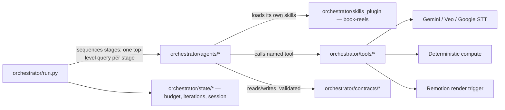

# Architecture Spine — book_reels — Claude Agent SDK Orchestration

## Design Paradigm

**Agentic pipes-and-filters.** The pipeline stays a sequential chain of stages (pipes-and-filters), but each filter is one of three things, never a mix:

1. A **Claude agent** — owns reasoning, writing, planning, or QA judgment.
2. A **Google/Gemini capability tool** — owns a capability Claude cannot perform itself (image generation/editing, TTS, video generation, speech alignment).
3. **Deterministic code** — owns pure computation with no judgment involved.

Every agent reaches (2) and (3) only through tools behind a hexagonal port — an agent never calls Gemini or a script directly; it calls a named tool, and the tool is the adapter. Layers map to directories:

```text
orchestrator/
  run.py       # core: sequences the stages in code; session/budget/iteration state, failure-report writer
  agents/      # core: AgentDefinition specs — the reasoning filters, each run as its own top-level query()
  skills_plugin/  # the `book-reels` plugin: each agent's know-how as skills (AD-16)
  tools/       # port/adapter: @tool-wrapped Gemini, Veo, STT, and deterministic calls
  contracts/   # the validated shape crossing every stage boundary
  state/       # run manifest: budget spent, iteration counts, session id
```



## Invariants & Rules

### AD-1 — Capability boundary: Gemini/Google only where Claude cannot act

- **Binds:** all agent and tool definitions
- **Prevents:** reasoning/writing/planning work being needlessly routed through Gemini when Claude can do it directly, and Claude being used for media generation it cannot perform
- **Rule:** Only image generation/editing, TTS synthesis, Veo video generation, and Google STT/Chirp alignment may be implemented as Google/Gemini API tool calls. All understanding (including raw image/screenshot understanding), writing, review, revision, and planning work is implemented as Claude agent reasoning over the input directly — never proxied through a Gemini text or vision call. `gemini_tools.py` therefore exposes only generation/editing and TTS, never an "understand this image" tool. `[ADOPTED]`

### AD-2 — Agent-per-responsibility, not one monolith

- **Binds:** `orchestrator/agents/`
- **Prevents:** a single agent prompt accumulating unrelated responsibilities (story writing mixed with Veo troubleshooting mixed with visual QA) and becoming unmaintainable
- **Rule:** Each pipeline responsibility — asset understanding, story writing, visual planning, Veo generation + QA, stills generation + QA, voice + word-timing + subtitle QA — is its own `AgentDefinition`, scoped to only the tools it needs. Each stage is its own top-level `query()`; the orchestrator sequences stages in code. It never delegates through the Agent tool, because the CLI's `--agent` delegation mode silently drops `output_format`, so each agent's prompt and tools are lifted onto a top-level session instead (rationale verified live, recorded in `orchestrator/agents/asset_analyst.py`'s `analyze_assets` docstring). The orchestrator never performs a stage's reasoning itself. The one exemption is AD-13's preflight: a pass/fail verification involving no judgment, so it runs as plain orchestrator code, not an `AgentDefinition`. `[AMENDED 2026-09-24 — originally worded as the orchestrator delegating to agents via the Agent tool; that was never how it was practised.]`

### AD-3 — Existing scripts become in-process tools, not subprocesses

- **Binds:** `orchestrator/tools/`, the 14 existing root scripts
- **Prevents:** tool wrappers diverging on integration style — one shelling out, another importing — and disagreeing on error-handling and state-passing shape
- **Rule:** Every existing script's logic is refactored into a plain Python function wrapped with `@tool` + `create_sdk_mcp_server`, invoked in-process. No orchestrator tool shells out to `python script.py`. `[ADOPTED]`

### AD-4 — Validate-then-proceed at every stage boundary

- **Binds:** `orchestrator/contracts/`, every tool/agent handoff
- **Prevents:** a malformed or drifted output (e.g. `analyzed_assets.json` changing shape) silently breaking a downstream stage instead of failing where it happened; and "the API call returned 200" being mistaken for "the result is good" (the existing pipeline's own recorded lesson: generation succeeding is not the same as an asset being approved)
- **Rule:** Every stage's output must clear schema conformance against its pydantic contract model before the next agent or tool may consume it — always required, for every stage. A **generative/creative** output specifically (narration, a generated image or clip, a visual/shot plan, a prompt) additionally requires the producing agent's own semantic/quality judgment (visual QA for an artifact, tone-match for a prompt against its narration segment, duration/length targets for narration) before it counts as approved — schema validity alone is never treated as approval for these. A **deterministic-tool** output (ingest, word-timing alignment, subtitle segmentation) instead clears its quality gate via the mechanical validator already in the code (e.g. the existing alignment-ratio thresholds) and is never re-judged by an LLM — per the existing `AGENTS.md` ban on replacing deterministic subtitle segmentation with free-form LLM output. Either gate failing returns control to the producing agent/tool to self-correct and retry; nothing is passed downstream unvalidated. `[ADOPTED]`

### AD-5 — Bounded retry, no infinite loops

- **Binds:** every validate-and-reiterate loop, every agent definition
- **Prevents:** an agent looping indefinitely against an unfixable failure, burning cost with no terminal state
- **Rule:** Every retry/reiterate loop has an explicit iteration ceiling — default carried forward from existing code precedent (4 for a generate→review→revise loop, 3 for a transient-failure retry), overridable per agent where evidence justifies it `[ASSUMPTION — confirm per agent once real runs produce evidence]`. Exhausting the ceiling triggers AD-6, never another silent retry.
- **Amendment (Story 4.2):** A vendor refusal is not a failed attempt. `run.py` checks four refusal routes: a Claude SDK exception, a `ResultMessage.is_error`, a paid tool's failure contract, and Veo `SDK_ERROR`. `classify_vendor_refusal` sorts what it finds into three classes: `transient` (429, "rate limit"), `hard` (usage/session/spend limit, quota, 401/403, credentials, unauthorized) and `none`. A vendor refusal gives back the pre-incremented attempt and draws no conservative charge. Only its real costs are charged: the Claude cost reported, plus every paid call the `PostToolUse` hook saw bill. A transient refusal gets at most 3 backoff reruns of the same attempt, about 2 minutes in all, and only on a route with no retry of its own (Veo, Codex). The Claude CLI and the Gemini image path already back off, so a transient refusal there goes straight to the hard path. `[AMENDED 2026-09-24]`

### AD-6 — Hard halt + failure report on exhausted retries

- **Binds:** `orchestrator/run.py`, every agent
- **Prevents:** the run silently degrading with a substituted asset, or blocking on a live prompt when nobody is watching
- **Rule:** When any agent exhausts its iteration ceiling without a valid result, the run halts at that stage and writes a diagnostic failure report to the run's output location. Every agent's report shares one minimal common envelope — stage id, failed contract name, attempt count, timestamp, partial-artifact paths — so AD-14's resume can read any agent's halt consistently; diagnostic detail beyond that envelope is agent-specific (format deferred). The run never substitutes a fallback asset and never waits on a live human response mid-run. `[ADOPTED]`
- **Amendment (Story 4.2):** The envelope gains `reason_code` (`vendor_limit`, `budget_exhausted`, `retry_ceiling`, …; default `unclassified`) and `resumable` (true for `vendor_limit` and `budget_exhausted`). Both fields have defaults, so an old report still builds. A hard vendor refusal, or a transient one still failing after backoff, halts with `vendor_limit` whatever outcome the agent returned. That halt is resumable: re-running the command re-runs preflight (AD-13) and resumes the stage (AD-14). "Pause" always means this halt, never a live wait. For `budget_exhausted`, "resumable" means resumable after raising `MAX_BUDGET_USD`, because spend accumulates across runs; the halt message says so. `[AMENDED 2026-09-24]`
- **Amendment (Story 4.4):** In shot production, a shot's failure doesn't halt the run on the spot. The production step collects every shot's result and writes **one** report. The envelope gains an additive `failed_shots` list (default empty), with one entry per failed shot: sequence, agent, scope, failure stage, reason, `reason_code`, resumable, attempts and paths. With one failed shot, the envelope is that shot's. With several, the stage id is `production`, and the `reason_code` is that of the systemic failure that stopped launches, or else the lowest-numbered shot's. A shot-specific hard failure defers the halt until its sibling shots have finished (AD-17). `[AMENDED 2026-09-24]`

### AD-7 — Per-run budget ceiling

- **Binds:** `orchestrator/run.py`, every paid tool call
- **Prevents:** an autonomous run — nobody watching each stage — spending unbounded Gemini/Veo/TTS/STT cost, including an agent's own AD-5 retry loop blowing through the ceiling before `run.py` ever gets a chance to notice
- **Rule:** Every run is configured with a budget ceiling before it starts, via the SDK's `max_budget_usd` — the only *enforced* hard stop (it returns `error_max_budget_usd`). `TaskBudget`/`task_budget` is advisory token-pacing only (requires the `task-budgets-2026-03-13` beta) and never substitutes for `max_budget_usd`'s enforcement. Every paid tool call (Gemini/Veo/TTS/STT) checks remaining run budget synchronously immediately before executing, giving AD-5's per-agent loop and this ceiling one shared enforcement point. Hitting the ceiling halts the run the same way as AD-6 — failure report, no silent continuation. The ceiling's value is run-time configuration, not fixed in this spine. `[ADOPTED]`
- **Amendment (Story 4.2):** Inside an agent query, the pre-call enforcement point is a `PreToolUse` hook, `PaidToolGuard` in `orchestrator/agents/_guard.py`, bound to each Veo and stills query. It denies a paid MCP call (`generate_veo_seed`, `generate_still`, `generate_veo_clip`) when the paid cost already allowed in that query plus this call's configured cost would exceed the limit. Today the limit is the run's remaining budget; Story 4.3 makes it the attempt's reservation. After the query, the orchestrator halts with `budget_exhausted` whatever the agent returned. The guard's matchers are merged with AD-16's `Read` guard, not substituted for it. TTS and STT are called by the orchestrator, not inside a query, so they keep the `_check_budget` gate. `[AMENDED 2026-09-24]`
- **Amendment (Story 4.3):** Every shot attempt runs inside a reservation from the run's budget ledger (`orchestrator/state/budget_ledger.py`). The reservation is `CLAUDE_SHOT_ATTEMPT_CAP_USD` plus the attempt's paid-call costs: image + Veo for a Veo shot, image for a still. It is taken before the query starts, and every retry takes a fresh one. The query's `max_budget_usd` is the cap, never the run's remaining budget. The `PaidToolGuard` limit is the attempt's unspent reservation less that cap, because the query's own `max_budget_usd` holds the Claude share. Real costs are debited as reported; a crash is charged the attempt's whole reservation; the unspent part is released when the attempt ends, on every path. A debit past its reservation comes from the unreserved pool (`MAX_BUDGET_USD` − spent − open reservations), and a negative pool halts with `budget_exhausted`. So total spend can exceed the ceiling only by one Claude turn past its cap. `[AMENDED 2026-09-24]`

### AD-8 — Locked artifacts protect approved reels, not in-run self-correction

- **Binds:** `orchestrator/agents/story_agent.py`, `visual_agent.py`, `voice_agent.py` (owns `subtitle_cues.json`); AD-4's retry loop
- **Prevents:** conflating "don't silently overwrite what the user already approved" with "an agent can't revise its own draft mid-run"; and conflating "a video rendered" with "a video was approved"
- **Rule:** The existing `AGENTS.md` prohibition on rewriting locked narration/subtitle cues/shot timing without explicit user direction governs a reel's artifacts only from the moment the human records approval at the final-review checkpoint (or an explicit reject/regenerate signal) — never merely from "the video rendered." Before that recorded event, any agent's own validate-and-reiterate loop may freely revise its own draft while producing the reel end-to-end; those in-run revisions are the mechanism, not a violation. A re-invocation before approval is unambiguously AD-14's resume; only after approval does touching those artifacts again become "a subsequent run" requiring explicit user direction.

### AD-9 — Veo/image-generation tools never receive a raw source screenshot

- **Binds:** `veo_agent.py`, `veo_tools.py`
- **Prevents:** repeating the pipeline's own documented failure mode, where a lost seed-result record silently fell back to feeding an uncleaned raw screenshot into Veo generation
- **Rule:** `veo_tools`'s generation call only accepts a path produced by the image-recomposition tool under its own contract. It rejects and fails loud on a `source_images/` path rather than silently substituting one. `[ADOPTED — carries forward existing AGENTS.md policy]`

### AD-10 — Per-shot contracts are keyed and merged by a single writer, never overwritten wholesale

- **Binds:** `orchestrator/contracts/`, `orchestrator/state/`, `orchestrator/run.py`
- **Prevents:** repeating the pipeline's own documented bug, where generating one shot's asset silently erased another already-recorded shot's result (a lost GCS URI, a lost seed reference); and a lost-update race where two agents each independently read-merge-write the same shot-keyed file
- **Rule:** Any contract or state file that accumulates one entry per shot (or other unit) is written via a keyed upsert — merge by shot id — never a full-file overwrite driven by a single-shot run. The orchestrator (`run.py`) is the sole writer-of-record for any such shared file: an agent returns its validated per-shot result to the orchestrator, which performs the merge; no agent writes the shared file directly.
- **Amendment (Story 4.3):** One orchestrator-owned lock, `STATE_LOCK` in `orchestrator/state/run_manifest.py`, serialises every production-asset upsert, run-manifest save and budget-ledger change, so concurrent shots never lose an update. It is held only around synchronous code, so the event loop and the worker threads that run the paid tool handlers can both take it. `session_id` in the manifest is last-writer-wins once shots run concurrently. `[AMENDED 2026-09-24]`

### AD-11 — Production asset selection goes through a named manifest, never a heuristic

- **Binds:** `veo_agent.py`, `stills_agent.py`, `orchestrator/contracts/`
- **Prevents:** repeating the pipeline's own documented bug, where an old test object left in the GCS bucket was nearly mistaken for the real shot because a script picked "newest" or "largest" instead of the approved mapping
- **Rule:** A `ProductionAssetsContract` records the one approved artifact per shot, subject to AD-10's single-writer rule. Any agent selecting a generated asset for downstream use reads this contract; it never infers "the right one" from bucket listing, filename, or recency.

### AD-12 — Veo results are inspected structurally, never assumed from a coarse status

- **Binds:** `veo_tools.py`, `veo_agent.py`, `orchestrator/contracts/`
- **Prevents:** repeating the pipeline's own documented failure, where a "completed" operation still needed manual inspection to find the actual video URI or an RAI-filter rejection reason; and two independently-built components disagreeing on the shape of a Veo failure
- **Rule:** The Veo tool inspects both `operation.response` and `operation.result`, distinguishes `video.uri` from `video.video_bytes`, and surfaces any RAI-filter reason as an instance of one named `VeoFailureContract` (in `orchestrator/contracts/`) — never an ad hoc shape invented independently of AD-4's contract model — feeding AD-4/AD-5's validate-and-retry loop.

### AD-13 — Credential/environment preflight runs before any budget is spent

- **Binds:** `orchestrator/run.py`
- **Prevents:** an unattended autonomous run burning turns and wall-clock time only to fail on the first Google API call because ADC/Vertex auth or GCS bucket access was never valid — including a *resumed* run that skips this check because it isn't literally starting at stage 1
- **Rule:** Before executing the first stage of **any** invocation — a fresh run or an AD-14 resume starting from a later stage — the orchestrator verifies Google Cloud ADC/Vertex auth and required bucket access; a preflight failure halts immediately (AD-6's failure-report path) before any agent or paid API call runs.

### AD-14 — A halted run resumes from its last valid stage, never restarts from scratch

- **Binds:** `orchestrator/run.py`, `orchestrator/state/`, every contract
- **Prevents:** re-spending on Gemini/Veo/TTS calls that already produced a validated result, every time a later stage is the one that hard-halts; and a resume pointer silently drifting out of sync with what's actually been validated
- **Rule:** Every stage's validated contract output is durably persisted (with the SDK `session_id`) as soon as it passes AD-4. Re-invoking a halted run scans `orchestrator/contracts/` for the newest validated record per stage — the resume point is **derived** from these records, never tracked as a separate counter that could fall out of sync with them — plus the persisted `session_id`, and continues from the first stage lacking a valid record. It never re-runs an already-validated stage. `[ADOPTED]`

### AD-15 — visual_agent owns shot-mode *intent*; the orchestrator alone applies mechanical feasibility

- **Binds:** `visual_agent.py`, `run.py`, `veo_agent.py`, `stills_agent.py`
- **Prevents:** two generation agents disagreeing about who has final say over one shot's still-vs-Veo mode after a QA failure — one hard-halting on it, the other silently picking it up; *and* a creative planner being forced to decide a question it provably cannot answer, because real per-shot durations do not exist until the voice stage has run
- **Rule:** `visual_agent` alone makes the creative call about which beats deserve real motion, and expresses it as a ranked, non-binding nomination (`video_candidate_rank`, `video_motion_intent`) on each shot of the visual-plan contract. It never writes `generation_mode`; that field is not in its output schema. The orchestrator (`run.py`), and only the orchestrator, converts nominations into `generation_mode`, in one deterministic step immediately after cue-derived shot timing is backfilled, applying exactly three mechanical constraints and no judgment: (a) the shot's real duration must fit inside a single Veo clip at the configured maximum clip length — no extension, stretching, or splitting across clips is permitted; (b) at most `MAX_VEO_SHOTS` shots are promoted, highest-ranked first — the cap is the `MAX_VEO_SHOTS` setting (default 3, `0`–`10`); (c) a promoted shot is demoted back to `STILL` if the run's remaining budget cannot cover its generation. Falling short of the video-shot target is logged and the run continues; it is never a halt. `veo_agent`/`stills_agent` still generate only for the mode they were handed and may never change it; AD-6's hard-halt still applies to that assigned mode, and to Veo retry-ceiling and non-retryable failures, which signal a real seed/QA defect rather than a resource limit. Every shot carries `still_motion` at all times so promotion and demotion are lossless and reversible; the renderer ignores it on a video shot. `[AMENDED 2026-09-19 — the original rule required visual_agent to assign generation_mode directly; that proved unsatisfiable, because the planner runs before any real shot duration exists, and in practice produced reels with no video at all.]`
- **Amendment (Story 4.3):** (c)'s demotion is decided only before launch. When shot production begins, a planning step (`run_production_planning`) computes every pending shot's first-attempt reservation (AD-7) and demotes the lowest-ranked Veo shots to stills until they all fit, writing `visual_plan.json` there and nowhere else, once per launch (a resume plans again). The planning step checks these reservations but doesn't hold them: each attempt reserves when it starts, so an earlier shot's retries can still leave a later shot unable to reserve, which is a `budget_exhausted` halt. If even the stills can't fit, the run halts with `budget_exhausted` before any paid call. A retry that can't reserve is a `budget_exhausted` halt, never a demotion. `[AMENDED 2026-09-24]`
- **Amendment (Story 4.4):** The halt for a Veo retry-ceiling or non-retryable failure is shot-specific. It is deferred until the sibling shots finish, and it is reported with theirs in one report (AD-6, AD-17). With shots running concurrently, a reservation that fails while sibling attempts hold reservations waits for one of them to be released. It counts as `budget_exhausted` only once nothing else is held, which is the same condition as when shots ran one at a time. `[AMENDED 2026-09-24]`

### AD-16 — Agent know-how lives in skills in one pipeline plugin, loaded per agent, never from `.claude/`

- **Binds:** `orchestrator/skills_plugin/`, `orchestrator/agents/`, `orchestrator/run.py`
- **Prevents:** domain rules duplicated between agents (the character-likeness QA block once lived in both the Veo and stills prompts) drifting apart; prompts growing into unmaintainable strings; and developer tooling (`CLAUDE.md`, `.claude/skills`, user settings, bundled CLI skills) silently steering a pipeline agent
- **Rule:** Each agent's domain know-how is a skill (`SKILL.md` plus one-level `references/`) in the single local plugin `book-reels` at `orchestrator/skills_plugin/`; a rule shared by agents exists in one skill. Each agent's prompt holds only its role, its boundaries, the contract it returns and an instruction to use its skills. Each agent loads the plugin through an absolute path built from `__file__` and names only its own skills in `skills=[...]`, in the qualified `book-reels:<skill>` form. Isolation is enforced in code: `setting_sources == []` is asserted when options are built; bundled CLI skills are switched off; and the init message is checked — every listed skill must be `book-reels:*` (or the CLI built-in `doctor`), the only plugin must be `book-reels`, and the agent's own skills must be present — otherwise the stage halts through AD-6 with no retry, and a shot stage charges nothing. Bare `Skill` is a tool, never an allow rule. Agents whose only file need is their skills get a `PreToolUse` hook that denies `Read` outside the plugin folder, because permission rules can't narrow `Read`. Deterministic likeness logic (the seed prompt ladder) stays in code; skills hold judgment criteria only. Evidence: `docs/implementation-artifacts/spike-4-1-sdk-skills.md`. `[ADOPTED 2026-09-24]`

### AD-17 — Independent shots run concurrently; failure scope decides whether siblings continue

- **Binds:** `orchestrator/run.py` (`run_production_stage`), `orchestrator/tools/vendor_limits.py`, `orchestrator/state/`
- **Prevents:** a reel taking the sum of every shot's generation time; one shot's defect throwing away its siblings' paid work; and a vendor or budget stop letting yet more paid work start
- **Rule:**
  - **Launch.** One production step, run after the voice stage, replaces the sequential Veo → stills pair. Production planning (AD-15(c)) fixes each shot's mode first. Then every pending shot is an asyncio task. Veo shots launch first, then stills, each in sequence order. At most `SHOT_CONCURRENCY` shots are in production at once, and the per-vendor semaphores inside the paid tools cap the vendor calls under them.
  - **Budget.** Every attempt runs inside its own reservation (AD-7). `STATE_LOCK` serialises every AD-10 write.
  - **Shot-specific failures.** A retry-ceiling exhaustion, or a non-retryable Veo or still failure contract, lets every sibling run to completion and be persisted.
  - **Systemic failures.** Any other failure is systemic: a vendor limit, budget exhaustion, a skill-isolation leak, a crash, or an unaccountable result. It stops new shot launches and new attempts. An attempt in flight is never cancelled, because a submitted Veo operation bills anyway. It finishes and is persisted if approved.
  - **Halt.** Then the run halts with one report (AD-6).
  - **Resume.** A resume skips every persisted shot (AD-14). The failed, stopped and unstarted shots run again, with their retry counts and ladder state read from their persisted attempt records. A shot that used up its retry ceiling halts again at once, until its ceiling is raised in `config.json` (AD-5). `[ADOPTED 2026-09-24]`

### AD-18 — Approving generative output needs an independent fresh-context reviewer, sequenced in code

- **Binds:** `orchestrator/run.py` (`run_bounded_agent_stage`, `run_narration_stage`, the shot producers), `orchestrator/agents/story_critic.py`, `orchestrator/agents/visual_reviewer.py`, `orchestrator/contracts/review.py`
- **Prevents:** the generator grading its own work, with a producer's self-QA being the only thing between a flawed narration, seed, clip or still and the reel
- **Rule:** Refines AD-4. A producing agent's own semantic/quality judgment is necessary but not sufficient. A generative output counts as approved only when a separate top-level `query()` also approves it. The orchestrator sequences that query in code, never as a subagent. It shares none of the producer's session and never sees the producer's QA summary.
  - **Story.** The story critic (skills story-craft and source-fidelity, Read confined to the plugin) runs through `run_bounded_agent_stage`'s `review_before_persist`, only after a fresh attempt passes `validate_contract`. It never runs on the resume-skip path. It returns a `StoryCritiqueContract`. REVISE is the next attempt's feedback and counts toward the AD-5 ceiling; only APPROVE persists the plan.
  - **Shots.** The visual-QA reviewer (skills visual-qa and character-likeness-qa, Read confined to the plugin plus that shot's asset files and character references) runs inside the shot task, after the producer approves and before `upsert_production_asset`. It returns a `VisualQAVerdictContract`. A rejection is written into the attempt record as `structured_output.failure` (stage `seed_qa`, `clip_qa` or `still_qa`) and takes the producer-QA-failure path. For Veo, a likeness `seed_qa` rejection (`CHARACTER_LIKENESS`) moves the likeness ladder, and resume reads it back from that record. `ProductionAssetEntry.reviewer_summary` sits next to the producer's `qa_summary`.
  - **Budget.** Each query runs at `CLAUDE_REVIEWER_CAP_USD`. Each shot attempt's reservation (AD-7) holds one review. The story agent's budget is the remaining budget less that cap, and the critic runs only when the cap is left. Its cost is charged to the run.
  - **Failures.** A vendor refusal of either query gives back the attempt and halts `vendor_limit` (AD-5). The Veo producer makes the seed and the clip in one session, so a reviewer's seed rejection arrives after the clip is paid for. That is accepted, because the producer's own seed QA still gates the clip. `[ADOPTED 2026-09-24]`

### AD-19 — Observability is opt-in via env, fails open, and never records secrets or media bytes

- **Binds:** `orchestrator/tracing.py`, `orchestrator/run.py` (`main`, `run_stages`, the shot task, the voice and delivery steps, `_halt`), every pipeline agent module's `query` binding, and the vendor tool bodies in `orchestrator/tools/gemini_tools.py` and `veo_tools.py`
- **Prevents:** a tracing backend that breaks, slows or leaks from a run; agents' Claude turns silently going untraced because each agent module bound `query` at import time
- **Rule:**
  - **Opt-in.** Tracing is on only when `LANGFUSE_PUBLIC_KEY` and `LANGFUSE_SECRET_KEY` are set, with `LANGFUSE_BASE_URL` choosing the region. Without them, neither Langfuse nor the instrumentation is imported, and the run is unchanged. The Langfuse project and keys are created once, by hand, in the UI; nothing is auto-created.
  - **Shape.** A run is one trace, opened right after `start_run` in session `<project>:<run_id>` and tagged with the project. Each stage is a span (`preflight`, `asset_analyst`, `story_agent`, `visual_agent`, `voice`, `production`, `delivery`). `story_critic` is a span inside `story_agent`, one per critique, and each shot is a span opened inside its own task. A halted stage carries the halt fields and ERROR, as does the step it halted in. Vendor calls and deterministic steps are spans made by hand. Claude turns come from OpenInference's instrumentor. The instrumentor takes effect because every agent resolves `claude_agent_sdk.query` at call time (`agent_query`), and our span around it adds the system prompt and the skill names. Nesting across concurrent shots and `asyncio.to_thread` rests on contextvar propagation.
  - **Fails open.** Every tracing call swallows its own errors. The exit flush runs in a daemon thread joined with a timeout. The provider is ours, not global, and has no atexit hook, and Langfuse's atexit shutdown is unregistered.
  - **No secrets or media.** Values are redacted before they reach a span: key and token patterns, secret-named env values, data URIs and base64 runs. On top of that, a span processor redacts every finished span before Langfuse's exporter (and its media upload) sees it. Text is truncated at `LANGFUSE_MAX_CHARS` (default 20000). `[ADOPTED 2026-09-25]`

## Consistency Conventions

| Concern | Convention |
| --- | --- |
| Naming (entities, files, interfaces, events) | Agents are named by responsibility, not by legacy script name (`story_agent`, not `story_director_agent`). One `create_sdk_mcp_server` per `tools/*.py` file, server name = module name (e.g. `veo_tools.py` → server `veo`), giving predictable `mcp__veo__generate`-style tool names. |
| Data & formats (ids, dates, error shapes, envelopes) | Every `metadata/*.json` shape gets a matching pydantic model in `orchestrator/contracts/`, named `<Artifact>Contract` after the artifact it validates (e.g. `VeoSeedContract`, `VeoResultContract`, `ProductionAssetsContract`, `VeoFailureContract`) — never after the owning agent, since one agent may own several distinctly-named contracts. A contract evolves by adding fields, never by silently changing an existing field's type or meaning. |
| State & cross-cutting (mutation, errors, logging, config, auth) | Run state (budget spent, per-agent iteration counts, session id, derived resume pointer) lives in `orchestrator/state/`, separate from the pipeline's own `metadata/*.json`/contract outputs. Consolidating the 14 scripts into `orchestrator/tools/` also centralizes their previously per-script-duplicated config (`PROJECT_ID`, region, model name) into one settings module every tool file reads, rather than re-duplicating the literal in each new file; ADC auth is threaded through that same settings module, not re-initialized per tool. A failure report is always written to the run's output folder — never only logged to stdout. |

## Stack

| Name | Version |
| --- | --- |
| claude-agent-sdk (Python) | 0.2.152 (requires Python ≥3.10) — **not yet installed** in `kayak-video`; first implementation step |
| pydantic | 2.13.4 — already installed in `kayak-video` (a `google-genai` transitive dependency); no new pin needed |
| google-genai | 2.23.0 as actually installed in `kayak-video` (verified via `pip show`) — do not upgrade reflexively (existing `AGENTS.md` policy; that policy is a process rule, not a version pin). `docs/book_reels_troubleshooting_agent_playbook.md`'s "2.19.0" figure is stale; the installed env is the source of truth, not that doc — `AGENTS.md` inherited the same stale figure and should be corrected separately. |
| Python runtime | existing `kayak-video` conda env (3.11) — satisfies the SDK's ≥3.10 floor |
| Remotion | 4.0.524 — separate npm project, unchanged, final deterministic render |

## Structural Seed

```text
orchestrator/
  run.py                    # sequences stages (one top-level query() each), session/budget/iteration state, failure-report writer
  skills_plugin/            # `book-reels` plugin: skills/<skill>/SKILL.md + references/ (AD-16)
  agents/
    asset_analyst.py        # AgentDefinition: screenshot/image understanding (Claude's own vision, no Gemini call)
    story_agent.py          # AgentDefinition: narration write + self-review + revise loop
    visual_agent.py         # AgentDefinition: shot/visual planning incl. ranked video nominations (AD-15)
    veo_agent.py            # AgentDefinition: seed prep + Veo generation + QA/retry
    stills_agent.py         # AgentDefinition: Remotion-still generation + QA/retry
    voice_agent.py          # AgentDefinition: TTS + word-timing + subtitle QA (mechanical gate, AD-4)
  tools/
    gemini_tools.py         # @tool: image edit/recompose, TTS only — no "understand" tool (AD-1)
    veo_tools.py            # @tool: Veo generate + operation/RAI-filter inspection -> VeoFailureContract (AD-12)
    stt_tools.py             # @tool: Google STT/Chirp alignment
    deterministic_tools.py    # @tool: ingest, subtitle DP segmentation, sync assets into remotion/public/, Remotion render trigger
  contracts/
    *.py                     # pydantic models per artifact: ..., ProductionAssetsContract (AD-11), VeoFailureContract (AD-12)
  state/
    run_manifest.py            # budget spent, iteration counts, session id; resume pointer is derived from contracts/, not tracked here (AD-14)
```

**Operational envelope:**

- **Invocation:** `orchestrator/run.py` is a CLI entrypoint (`python -m orchestrator.run <source_images_dir>`), matching `AGENTS.md`'s existing convention of a directly-run Python script from the repo root inside the `kayak-video` conda env. `[ASSUMPTION]`
- **Secrets/credentials:** unchanged from today — Google Cloud ADC (`gcloud auth application-default login`) against the existing Vertex project, the same mechanism AD-13 preflights. No new secret store is introduced.
- **Halt notification:** none, by design — consistent with choosing hard-halt-plus-report over a live notify-and-wait. The user checks the failure report in the run's output folder whenever they next look; nothing pages or messages them. `[ASSUMPTION — flag if an active notification is actually wanted]`

## Deferred

- **Multi-reel namespacing** — `metadata/`/`generated/` are flat, single-reel today; a per-reel path scheme is only needed once a second concurrent reel is attempted.
- **Exact per-agent iteration ceilings beyond AD-5's carried-forward defaults** — tune once real agent runs produce evidence.
- **Exact `remotion/public/` sync mechanics** (file layout, naming) — the sync tool's existence is fixed in the Structural Seed; the byte-level handoff format is `remotion/`'s own concern, a separate npm project out of this spine's scope.
- **Failure-report diagnostic-detail schema** — AD-6 fixes only the minimal common envelope; the per-agent diagnostic payload beyond that will emerge from the first real failure this design produces.
- **Fate of `review_story_plan.py` / `revise_story_plan.py` / `review_revised_story_plan.py`** — kept as-is, standalone, for the troubleshooting playbook's existing manual single-stage debugging workflow; not migrated into an agent and not part of the automated chain. Revisit if they go unused once the orchestrator is live.
